# Mobility Sandbox MV — Data Relationships Diagram

This is a conceptual relationship model for the file-based backend. It is not
a database schema. The same relationships will be represented through stable
IDs and references across normalized JSON, GeoJSON, graph, and derived files.

The source rules and provider endpoints are defined in
[`../apis.docs.md`](../apis.docs.md).

## 1. Core entity relationships

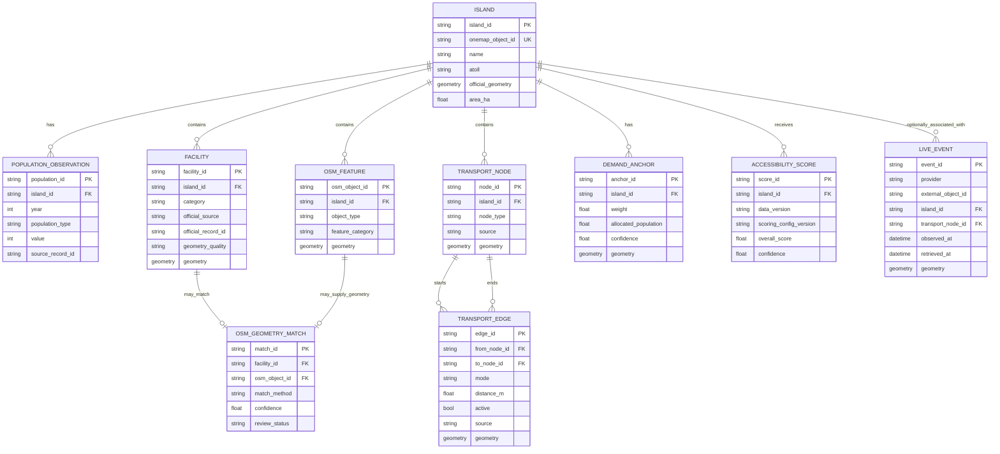

## 2. Source authority and normalization flow

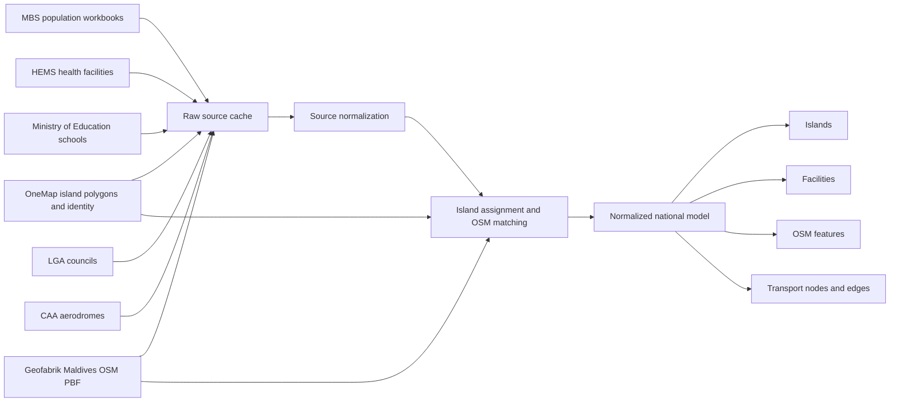

## 3. OSM relationships

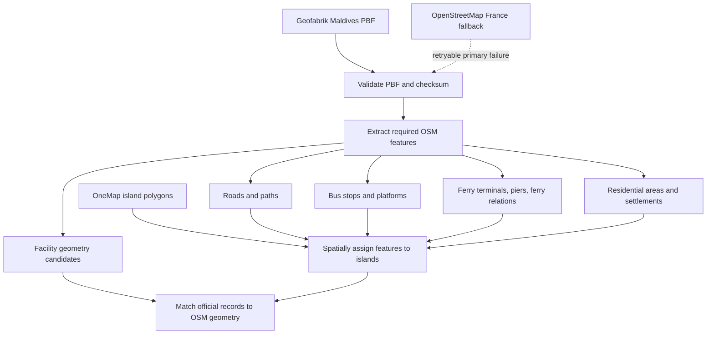

OSM provides geometry and routing context. It does not replace official
facility identity, population, airport certification, or island identity.

## 4. Transport graph relationships

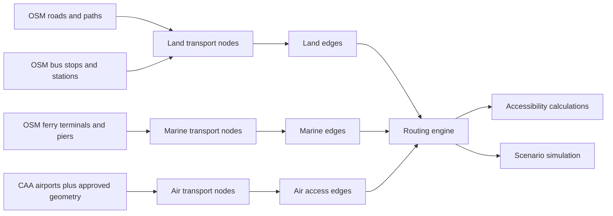

The graph uses stable node and edge IDs. Scenario operations create an
effective graph without modifying the baseline graph files.

## 5. OSM-backed transport modes

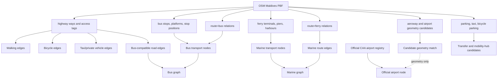

### OSM mode interpretation

| Transport mode | OSM relationship | What the backend may calculate |
|---|---|---|
| Walking | Pedestrian-compatible highway/path edges | Network distance and access |
| Bicycle | Bicycle-compatible highway/cycleway edges | Network distance and access |
| Taxi/private vehicle | Drivable highway edges and restrictions | Network distance and connectivity |
| Bus | Drivable roads plus mapped stops/routes | Stop access and bus-compatible connectivity |
| Public ferry | Ferry terminals and `route=ferry` relations | Static marine connectivity and distance |
| Airport access | OSM roads/paths/parking linked to CAA airport nodes | First/last-mile access |
| Speedboat | OSM jetty geometry plus approved vessel-service mapping | Passenger edge when mapped to an eligible island jetty |
| Dhoni | OSM jetty geometry plus approved vessel-service mapping | Passenger edge when mapped to an eligible island jetty |
| Larger/cargo vessel | OSM or MPL jetty geometry plus operator mapping | Cargo edge to an MPL-operated cargo jetty |
| Aircraft | CAA airport identity, OSM geometry, and ADSB.lol live position | Airport context and approved air-access relationship |

OSM does not establish schedules, frequency, active operation, vehicle type,
or service reliability. Those fields must remain absent or explicitly
unverified.

## 6. Operational vessel and aircraft mapping

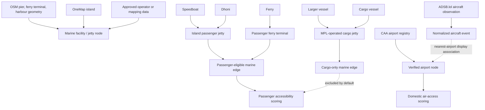

### Operational mapping rules

| Mapping | Allowed use | Default score treatment |
|---|---|---|
| Speedboat → island passenger jetty | Passenger movement | Eligible when route/service is approved |
| Dhoni → island passenger jetty | Passenger movement | Eligible when route/service is approved |
| Ferry → ferry terminal | Public passenger service | Eligible when active/approved |
| Larger vessel → MPL cargo jetty | Cargo loading/unloading | Cargo-only; excluded from passenger score |
| Cargo vessel → MPL cargo jetty | Cargo movement | Cargo-only; excluded from passenger score |
| Aircraft observation → nearest airport | Live map context | Does not create a flight route |
| CAA airport → island | Official domestic gateway | Eligible for air-access scoring |

Physical OSM geometry and operational service mapping are separate concerns.
An OSM jetty may be used as the physical location, but passenger eligibility,
operator, vessel class, cargo status, and active service require approved
mapping or authoritative provider data.

### Operational mapping records

```text
MarineFacility
    id
    island_id
    osm_object_id (optional)
    facility_role       # passenger_jetty | ferry_terminal | mpl_cargo_jetty | harbour
    operator (optional)
    passenger_eligible
    cargo_eligible
    geometry

VesselServiceMapping
    id
    marine_facility_id
    vessel_class        # speedboat | dhoni | ferry | larger_vessel | cargo_vessel
    service_role        # passenger | cargo | mixed
    route_id (optional)
    source
    confidence

Airport
    id
    island_id
    caa_record_id
    osm_object_id (optional)
    icao / iata (optional)
    geometry

AircraftObservation
    external_object_id
    provider            # adsb_lol
    position
    nearest_airport_id (optional)
    observed_at
    retrieved_at
```

The `VesselServiceMapping` is the explicit bridge between vessel class and
jetty. A live AIS position can be displayed near that mapped facility, but a
live position alone does not create a service mapping.

## 7. Demand and accessibility relationships

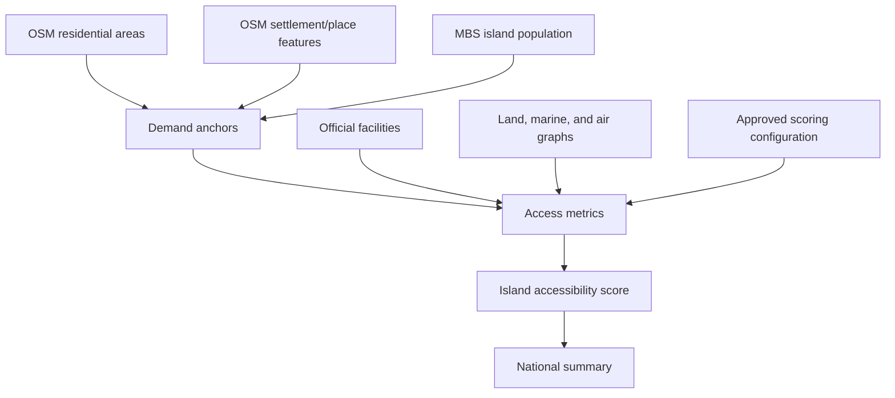

If official population is unavailable, population-weighted results remain
unavailable rather than being estimated silently.

## 8. Flight-data relationship

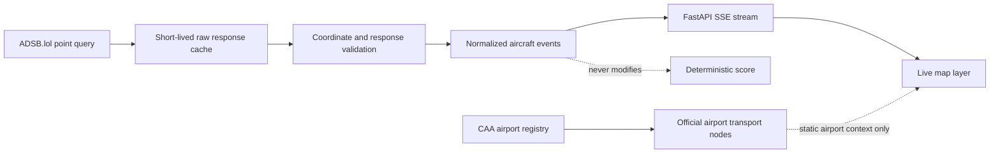

ADSB.lol aircraft observations are live context only. CAA remains authoritative
for airport identity, certification, and airport-to-island relationships.

## 9. Vessel-data relationship

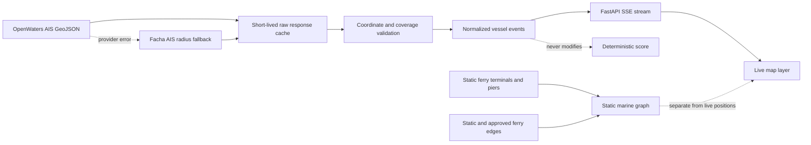

Live vessel positions must not be interpreted as ferry schedules, route
availability, or proof of passenger service.

## 10. Scenario and recommendation relationships

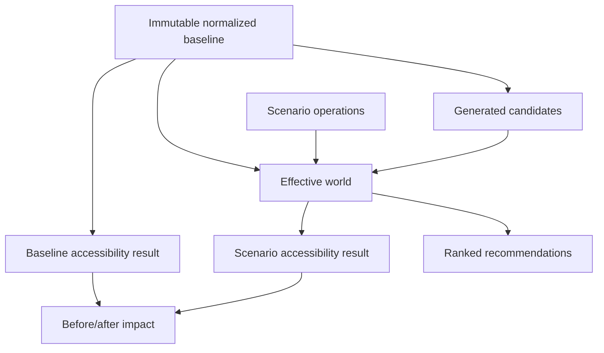

Recommendations and manual simulations must use the same routing and
accessibility engines.

## 11. FastAPI ownership boundary

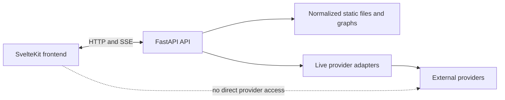

The backend owns provider access, caching, validation, normalization, error
handling, and secrets. The frontend receives only the normalized internal API.
