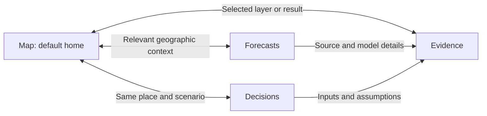

# Website audit and map-first product strategy

Reviewed 11 October 2026. This document retains the initial product audit below and the subsequent analytical-workspace redesign. Initial findings describe the earlier application; current implementation and verification are recorded in [the release record](prediction-release.md).

## Analytical workspace redesign

The second interface audit found that the analytical pages had accumulated useful functionality without a clear reading order. Forecasts repeated their purpose before showing the chart; Decisions delayed comparison behind explanatory strips; Evidence buried source inspection beneath a documentation-style page. Rounded cards and repeated summary tiles gave very different tasks the same visual weight. These are observed interface defects and design judgments, rather than findings from a policymaker usability study.

| Tab       | User question                                                                                    | Primary workflow                                                                                                                              | Secondary information                                                                                    |
| --------- | ------------------------------------------------------------------------------------------------ | --------------------------------------------------------------------------------------------------------------------------------------------- | -------------------------------------------------------------------------------------------------------- |
| Forecasts | What monthly passenger volume should we prepare for, and how reliable is that estimate?          | Select category and month; inspect recorded totals and outlook; compare historical errors and benchmark; prepare a resource review            | Exact monthly values, source definitions, methods, immutable forecast issues and workbook versions       |
| Decisions | Which tested change improves potential access, who is worse off, and what must be checked first? | Set common conditions; compare alternatives; inspect gains, losses, missing evidence and cost; explicitly test the selected option on the map | Island distribution, selected-area journey, bounded timing trials, operating assumptions and downloads   |
| Evidence  | Can this result support my decision, and what evidence is missing?                               | Check applicability by claim; inspect critical gaps; search/filter the source library and inspect an individual record                        | Geographic coverage, complete service gaps, source versions, policy context and attributed notice review |

The design uses one page title per task, a common navigation shell, restrained neutral surfaces, teal for selection and amber for consequential caution. Tables support side-by-side comparison and a source-list/detail pattern supports verification. Detailed methodology remains in the application through progressive disclosure. Main outputs retain their units, reporting period, scope, unknowns and qualifications. The map remains the home page and geographic investigation workspace; switching analytical pages preserves the current planning context.

Each visual must answer one of these questions. Decorative imagery, additional KPI tiles and unsupported national routing or live congestion are unnecessary. Forecast history remains a quantitative SVG so dates, values, recorded/estimated distinctions and uncertainty are inspectable and can change with the selected category and month.

### Findings by user need

| Perspective                     | Weakness found                                                                                                                              | Implemented response                                                                                                                                                                                                                                                                                          |
| ------------------------------- | ------------------------------------------------------------------------------------------------------------------------------------------- | ------------------------------------------------------------------------------------------------------------------------------------------------------------------------------------------------------------------------------------------------------------------------------------------------------------- |
| Nontechnical policymaker        | Repeated introductions and equal-weight cards obscure the actual choice. Identical default access counts can look like a failed comparison. | One task per page; a selectable comparison table and a computed takeaway explain whether any tested option increases access. Benefits and longer journeys appear together.                                                                                                                                    |
| Transport operator              | Aggregate forecasts can appear to justify a particular vehicle or departure change without route loads, capacity or costs.                  | Forecasts lead to an accountable resource review. Decisions show unpriced changes and required operator checks, rather than automatic approval.                                                                                                                                                               |
| Analyst                         | Static-looking charts hide calendar spacing and exact values; a large source list is difficult to inspect.                                  | Responsive calendar-spaced charts, month inspection, method/backtest disclosures and a filtered source-list/detail inspector.                                                                                                                                                                                 |
| GIS planner                     | Hundreds of road sections and anonymous residential areas are hard to locate from a selector alone.                                         | Optional search keeps stable map identifiers; explicit location/journey links preserve context and lead to the map. Area identifiers are not presented as verified neighbourhood names.                                                                                                                       |
| Statistics reviewer / organizer | Internal workbook IDs and missing UI metadata undermine provenance; a saved file can be mistaken for fitness for use.                       | Human-readable workbook receipts preserve original hashes and worksheet anomalies. Publisher attribution uses recognized source hosts; missing retrieval dates and reuse rights remain explicit. Applicability separates access modeling, exploratory monthly forecasts and unsupported live/national claims. |

The implemented journey is outlook → reliability/source review → operator resource review, or comparison → distribution/journey → explicit map inspection → evidence checks. Evidence entry from an analytical result selects its relevant source workflow while preserving the planning month and passenger category. Users can change the filter afterward. The original map remains the landing page.

Removing duplicate cards does not remove analytical records. Exact values, definitions, source versions, gap registers, notices and exports remain available as secondary inspection tools. The redesign does not add decorative raster assets because quantitative charts, tables and map geometry are the useful visuals here.

The highest-value remaining work requires better inputs: dated complete service calendars and destination availability for access decisions; route/direction loads and vehicle circulation for resource decisions; measured, timestamped road speeds and independent later outcomes for congestion/arrival prediction. These are evidence dependencies, not additional dashboard tiles. A nontechnical policymaker study remains necessary to test the reading-order assumptions with actual users.

## Initial product audit

The strongest direction is **a map-first planning workspace with prominent predictions and connected analytical pages**. Preserve the original atlas design. Bring the newer plain-language questions, transparent forecasts, benefits, losses and unknowns into that system. The most valuable next work is making the existing evidence lead to understandable decisions, rather than adding more independent features.

The product has a credible foundation: attributed public sources, reproducible modeled comparisons, official population anchors, explicit unknowns, reversible proposals and inspectable forecast benchmarks. It currently feels like two applications, and some navigation labels promise capabilities that the evidence does not yet support.

## Review scope and confidence

Four independent reviewers covered evaluator/product usability, statistics and organizer needs, GIS/transport operations, and map-first UI design. The primary reviewer inspected the working site at port 5180 on desktop and at 390 × 844, including the forecast opening, policy comparison, bus evidence, original atlas, area selection, mobile detail sheet and return navigation. Source review covered all eight areas listed below. Three forecast results were checked against the live API; mean absolute error and total error percentages were independently recomputed from their 18 evaluation rows. No arithmetic discrepancies were found in those checked calculations.

Coverage is **partial for interactive combinations**: every tool, timetable, source and proposal combination was not exercised. It is **complete for the eight named product areas at the source-review level**. Statements about likely user confusion are design hypotheses, not results from a human usability study. No real-world traffic or operator feasibility validation was performed.

**Assessment: needs revision before it becomes a dependable policy decision product.** It is a viable competition prototype when its experimental status and evidence limits remain visible.

| Category                                 | Observed defects                                                                                                                                           | Assessment                                                   |
| ---------------------------------------- | ---------------------------------------------------------------------------------------------------------------------------------------------------------- | ------------------------------------------------------------ |
| Landing and navigation                   | Home opens a forecast without a map; original atlas is behind More options; views cannot be described in the URL                                           | Revise around the user's map-first requirement               |
| Original atlas, mobile and accessibility | Useful map and area buttons survive; dense summary text; floating return button overlaps the mobile dock; simplified map lacks an equivalent area selector | Preserve the atlas and repair interaction details            |
| Passenger forecasts                      | Arithmetic checked; weak bus benchmark performance, poor historical range coverage and no frozen issue ledger                                              | Keep prominent with stronger evaluation and decision framing |
| Simplified policy comparison             | Fixed example; default options have identical access counts; a no-change conclusion still says Adjust bus times                                            | Make selectable and label actual conclusions                 |
| Advanced scenario editing and costs      | Separate scenario state from the simple view; loaded proposals can be saved, but selections and assumptions are not handed over                            | Integrate shared context; retain reversible editing          |
| Journeys and destination suitability     | Representative journeys and return tools exist; service completeness and arrival-time destination suitability remain incomplete                            | Keep limitations attached to outcomes                        |
| Sources, population and national context | Covered population exclusions are not prominent; source drawer lacks individual source dates; national coverage is readiness rather than routing           | Make coverage a first-class result                           |
| Bus evidence, notices and motion         | Bus evidence uses a scenario clock; no released trained delay predictor; news candidates require review                                                    | Correct promises and distinguish evidence types              |

| Category                   | Observed defects                                                                                                          | Assessment                                                                            |
| -------------------------- | ------------------------------------------------------------------------------------------------------------------------- | ------------------------------------------------------------------------------------- |
| Forecast calculations      | None found in the three checked MAE/WAPE calculations                                                                     | Checked arithmetic is sound within this scope                                         |
| Forecast validation        | Six overlapping later outcomes per series; historical publication availability is not reconstructed                       | Retrospective revised-source evaluation, not prospective operational proof            |
| Forecast uncertainty       | Later coverage is 2/6 for each ferry series and 3/6 for bus                                                               | Historical-error ranges are unsuitable as assured budget bounds                       |
| Units and geographic grain | Ferry direction/boarding definitions unresolved; counts are movements, not unique people or street demand                 | Keep categories separate; avoid spatial allocation                                    |
| Access denominators        | Approximately 246,278 allocated residents across three islands; Hulhulé is unallocated and harbour residents are excluded | Bounds cover included origins only; keep unavailable excluded population unquantified |
| Decision validity          | Access estimates do not establish passenger demand, operator feasibility, appointment availability or causal benefit      | Recommend investigation with conditions, not automatic implementation                 |

## What each customer actually needs

| Perspective                          | Main question                                                  | What works now                                                                         | What is missing or excessive                                                                                                     |
| ------------------------------------ | -------------------------------------------------------------- | -------------------------------------------------------------------------------------- | -------------------------------------------------------------------------------------------------------------------------------- |
| National policymaker                 | Where should we investigate, and what would a change do?       | Geographic access, conditional comparisons, losses and unknowns                        | A named decision, affected place, feasible alternatives, responsible reviewer and next evidence needed                           |
| Maldives Bureau of Statistics        | Can these results be traced, explained and reproduced?         | Official totals, attributed sources, quality notes and inspectable forecast history    | Source vintages, immutable forecast issues, clearer denominators and an in-app data-gap register                                 |
| Competition evaluator                | Can I understand the problem, contribution and result quickly? | Strong original atlas and transparent analytics                                        | One continuous demonstration; current no-change tiles obscure what was learned                                                   |
| Island council                       | Is my island underserved relative to its population?           | Island breakdowns and geographic context                                               | Residents assessed, access rate, unknown share and exclusions alongside absolute counts                                          |
| MTCC/RTL operator                    | Which schedule change is worth reviewing?                      | Bounded departure shifts, timetable preservation and conditional costs                 | Peak/route loads, vehicle circulation, duties, multiple time slices and explicit harm constraints                                |
| GIS/statistical analyst              | Can I inspect and repeat the model?                            | Original detailed editor, source catalog, versioned scenarios and return-journey tools | Shared state between pages, source freshness by layer, and accessible tabular spatial results                                    |
| Resident or community representative | What does this mean for my area?                               | Selected area and an example journey                                                   | Plain explanations, readable labels and clear positioning as planning estimates; eventual tested Dhivehi support                 |
| Emergency planner                    | What happens if a connection is disrupted?                     | Hypothetical closure/delay stress tests                                                | An explicit distinction between planning stress tests and operational emergency response; this is not an ambulance arrival model |
| Mobile, keyboard and first-time user | Can I answer the question without learning GIS?                | Old map sheets, suggested-area buttons and journey explanations                        | A short guided task, current help text, legible summaries and a complete workflow outside the canvas                             |

Primary users should be **policy/statistics staff**, with operators and analysts supporting their decisions. Residents are beneficiaries and consultation participants. Building a full public live trip planner would introduce a different service commitment and should not become the competition's core scope.

The official competition FAQ emphasizes useful transport data, GIS, operational/policy value, data use, execution, clarity and impact. This direction fits that brief. The FAQ does not publish a weighting scheme that would justify invented scoring percentages. [Official competition FAQ](https://www.datathon.stats.gov.mv/faq)

## Preserve the map-first design and connect the whole system

| Before                                                         | After                                                                                   | Why                                                                             |
| -------------------------------------------------------------- | --------------------------------------------------------------------------------------- | ------------------------------------------------------------------------------- |
| Forecast is the home page; original map is an exceptional mode | Original atlas is home, with a prominent passenger-outlook card                         | Keeps the user's preferred identity and makes the geographic question immediate |
| Two independently mounted workspaces                           | Shared shell and scenario context across Map, Forecasts, Decisions and Evidence         | Prevents accidental comparison of different settings                            |
| Many controls compete with the map                             | A small default question bar and one contextual panel; advanced tools remain available  | Simplifies the first minute without discarding useful capabilities              |
| Charts and map have no context-preserving links                | Show on map opens the relevant geography; Open analysis preserves the selected question | Makes separate pages one system                                                 |

Proposed navigation:

- **Map:** default home; access, affected areas, services, proposed changes and attributed notices.
- **Forecasts:** passenger outlook, recorded versus estimated totals, benchmark results, reliability and resource-review follow-up.
- **Decisions:** alternatives, benefits, harms, unknowns, feasibility conditions and next investigation.
- **Evidence:** definitions, coverage, source dates, verification, model methods and forecast issue history.

On desktop, keep the calm atlas, streets, route/facility symbols and lower tool dock. A contextual side panel should explain the selected area, forecast or alternative. Start with a plain question such as **Time to healthcare**, a readable legend, coverage status and a compact passenger outlook. Avoid several stacked sidebars competing for attention. Show only relevant outcomes: access and journey change for access scenarios; investment costs when an investment exists.

Use one primary analytical shading layer at a time, with routes and facilities as context. Recorded, modeled, predicted, proposed, assumed and unknown information need visible words and non-color cues. Journey-time shading must not resemble an unlabeled congestion map.

On mobile, retain the visible map and one collapsible bottom sheet, with explicit Expand/Collapse buttons. The current floating Back to policy decisions button sits over the tool dock; eliminate that temporary two-workspace navigation. Put the main estimate, latest recorded month and reliability caution together. Show two primary outcomes before details, rather than squeezing access, journey, cost and carbon into tiny explanatory text.

Shared context must include selected geography/origin, analytical layer, open panel, proposal, destination, service date/departure, journey target, disruption assumptions, dataset/model versions and camera. Preserve forecast series and target month separately. Browser Back and meaningful links should restore context. The old editor already saves its own version-pinned proposal; the current defect is missing handover and remounted view state, not deletion of every saved proposal.

Keep three clocks distinct: **service scenario date/time**, **forecast target month/latest recorded month**, and **bus report receipt time**. A shared global time slider would incorrectly imply that they describe the same evidence.

## Twelve findings to address

1. **Restore the map landing page.** The source default is `ahead`, and the original map is under More options. This directly conflicts with the user's stated preference. Restore the atlas shell and make prediction visible through its home card and global navigation.

2. **Preserve context across analytical pages.** Entering the original map and returning remounts the simple workspace at its opening forecast. Carry the same proposal, settings and selected place through every comparison and return link.

3. **Give the forecast a specific planning job.** Review the service budget and staffing is currently generic. Select an owner, planning lead time, review question and required supporting inputs. Monthly totals can help flag a service-resource review; they cannot determine peak frequency or fleet purchases without loads, capacity and operating data. October's estimate is a current-month nowcast from lagged actuals; distinguish this from a future-month planning forecast.

4. **Make weak predictive performance unavoidable.** Keep the bus model's unfavorable benchmark result and poor range coverage beside its estimate. Do not replace the model after examining these same outcomes and describe the replacement as independently validated. Choose the headline by the user's planning question, rather than whichever series has the best later error.

5. **Freeze forecast issues and evaluate them prospectively.** The API currently chooses the target from the current clock and regenerates the bundle. Record issue date, forecast target, available source cutoff/publication dates, source hashes, model version, estimate, range and benchmark predictions. Score later first-release totals and subsequent revisions separately. Changing the date or source must not rewrite a previously issued prediction.

6. **Correct the bus page's promise and clock.** Bus delays currently presents source-readiness evidence, not a trained delay forecast. Rename it Bus evidence for now. Its displayed scenario date, 10 October at 15:30, is not the pilot's collection window on 11 October. Receipt times also do not establish GPS measurement time.

7. **Turn the fixed worked example into a selectable investigation.** Name and highlight the assumed road, expose supported date/time and service choices, and show the tested alternatives. Until then, label it a worked example. Five-minute earlier/later shifts are a bounded test, not comprehensive timetable optimization.

8. **Label no-change conclusions and show trade-offs.** At the default 30-minute target, both tested shifts lose approximately 2,587 residents' modeled access, so the selected result correctly keeps the timetable. The card still says Adjust bus times. At a 15-minute target, the tested earlier R8 shift adds approximately 1,481 residents within target but makes approximately 6,079 residents' computable journeys slower. Show both outcomes; do not sell the positive count alone.

9. **Make denominator and unknown coverage explicit.** Approximately 246,278 modeled residents cover Malé, Hulhumalé and Vilimalé. Hulhulé cannot be independently allocated from the loaded projection, and harbour residents are excluded. All approximately 7,250 Vilimalé residents currently have unknown access. Access bounds describe included origins only; they do not account for excluded population or omitted services. Show exclusions separately from unknown journeys, leaving unavailable excluded totals unquantified; add island access rates and unknown shares alongside counts. These allocated residents are not observed passengers.

10. **Keep destination and journey validity attached to the result.** A selected hex area can contain mixed journeys; its displayed journey is representative. One-way access is not a verified appointment or return trip. Destination opening/eligibility checked at departure does not establish suitability at arrival. Retain the return tools and require appropriate service evidence before making that stronger claim.

11. **Repair accessibility, help and plain language.** The simplified map's shared help references a Services tray that is absent there. Retain the original keyboard-accessible area buttons and add a searchable/table alternative. Update the tour's obsolete Enter Edit map instruction to rendered controls. Explain passenger movements and total error in everyday language; keep unresolved source terms such as VM attributed instead of inventing their meaning. Rename Where should we invest? to Areas to investigate when the ranking is only a modeled journey gap.

12. **Show source dates and implications in the app.** Sources and dates currently lists links without each source's dates. Show reference period, publication/retrieval dates where available, coverage, verification and how the source affects this result. Preserve the richer original catalog. Keep important qualifications and next steps visible without requiring a PDF.

The modeled timetable and delay numbers above are conditional on the loaded partial 10 October snapshot and 15:30 departure. They do not demonstrate real intervention effects. Removing the assumed five-minute delay changes no default target-access count but saves about 0.383 minutes on average across matched computable journeys; the zero headline count therefore does not mean zero modeled journey benefit.

## Make prediction the analytical highlight

The verified official monthly source currently stops at June 2026; the bus June values repeat May and are quarantined. Keep that data-quality work visible as a contribution, rather than quietly filling the gap. [MBS monthly statistics](https://statisticsmaldives.gov.mv/monthly-statistics/), [June 2026 publication](https://statisticsmaldives.gov.mv/maldives-in-figures-june-2026/)

| Published series            |  October estimate | Mean absolute error | Selected model total error | Last-recorded-month baseline error | Later historical range coverage |
| --------------------------- | ----------------: | ------------------: | -------------------------: | ---------------------------------: | ------------------------------: |
| Malé VM ferry endpoint      | 226,205 movements |    10,899 movements |                      4.82% |                              6.62% |                             2/6 |
| Villigili VM ferry endpoint | 227,335 movements |    11,317 movements |                      4.98% |                              6.60% |                             2/6 |
| Malé/Hulhumalé bus category | 292,331 movements |    36,925 movements |                     12.33% |                              4.83% |                             3/6 |

Each row has six later historical target months; these are overlapping retrospective checks, not independent trials. Total error is WAPE: total absolute error divided by total recorded movements. It is not a probability of being correct. Ferry targets are January–June 2026; bus targets December 2025–May 2026. Publication availability and original historical vintages have not been reconstructed. The bus forecast loses to every displayed benchmark. See the [forecast implementation notes](prediction-release.md) and [source receipt](prediction-source-receipt.md).

Prediction development should proceed in this order:

1. **Define the decision and horizon.** Agree a service-resource review task with its lead time. Support explicit target months and explain when an estimate is a nowcast. Keep total movements separate from route demand and access.
2. **Publish a reproducible issue ledger and baseline scorecard.** Freeze estimates before future actuals arrive. Present simple benchmark forecasts and all failures. Historical comparisons remain useful, but label them retrospective.
3. **Improve methods using adequate evidence.** Compare persistence, recent averages and seasonality at the chosen horizon. Only add service calendars, holidays, disruptions or other predictors when their dates, definitions and availability are verified. With roughly four years of monthly history, model complexity must earn its place through chronological evaluation.
4. **Improve uncertainty and evaluate policy relevance.** Track coverage and width; do not call the current weak historical range a calibrated confidence interval. Evaluate whether forecasts improve the defined review task, using actual capacity/cost inputs when acquired.
5. **Pilot short-horizon corridor delay separately.** Collect trustworthy timed directional trips across multiple days, then compare corridor passage-time estimates against simple baselines using later days. Do not merge this target with aggregate monthly passenger forecasting.

On the map, show a compact forecast card linked to its **source-defined geographic category**. Highlight the named island/endpoint geography; use an exact terminal only after its correspondence is verified. Keep actual history solid and estimates dashed, with an accessible numerical table. Do not spread monthly totals across streets, hexagons, moving vehicles or assumed passenger loads. Keep both ferry endpoint categories separate while their counting directions remain unresolved.

On Forecasts, show target month, latest actual, estimate, model-versus-baseline performance, historical range limitations and **What should the agency check next?** A link back to Map should highlight the relevant geography without altering the service scenario.

## Congestion, moving vehicles, news and island coverage

**Congestion:** keep the useful road-delay stress test today, with a named road and explicit Assumed extra minutes label. A future measured layer needs timestamped segment travel times, direction, coverage and a declared comparison period. Display minutes of added travel time or a clearly defined speed/travel-time ratio; show unknown segments neutrally. Bus passage times include stops/dwell and cannot automatically describe general road traffic. Policy comparison should show beneficiaries, harms, alternative paths and operational constraints before recommending investigation of a blockage.

**Moving vehicles:** retain them as opt-in explanation. Separate timetable illustration from dated position replay; keep the date/status visible, allow pause/scrub and respect reduced motion. The ten-minute pilot covers four vehicles and ten snapshots, not enough independent trips/days for a released delay predictor. A moving icon must not imply current tracking, measured congestion or passenger load.

**News intelligence:** add an evidence inbox after the core workflow is coherent. Extract a candidate location, affected extent, start/end time, source, supporting passage and uncertainty. Let a reviewer verify or reject it; detect duplicates and expire notices. Only a reviewed event should become a proposed disruption, with its attribution attached. Do not automatically close roads from a headline. Keep extracted candidates visually distinct from confirmed notices and scenario assumptions.

**More islands:** prioritize completing useful Greater Malé evidence, especially Vilimalé ferry calendars, crossings and return journeys. The current national layer has 208 readiness records, 119 located; that is not national journey coverage. Add a further island only with a defined policy question, denominator, georeferenced services, usable connections/timing and coverage validation. Expansion should prove reuse of the method, rather than fill the map with unsupported estimates.

## Feature decisions

| Action                         | Features                                                                                                                                           | Reason                                                          |
| ------------------------------ | -------------------------------------------------------------------------------------------------------------------------------------------------- | --------------------------------------------------------------- |
| Keep and emphasize             | Original atlas; transparent forecasts; journey inspection; benefits/harms/unknowns; reversible proposals; source catalog                           | These explain a policy question with inspectable evidence       |
| Simplify                       | Navigation; summary metrics; labels; tours; comparison options; forecast language                                                                  | Reduce the effort needed to understand and act                  |
| Add first                      | Shared context/deep links; issue ledger; meaningful decision follow-up; geographic/source coverage; island rates; accessible area list             | Repairs the gaps that currently weaken usefulness and trust     |
| Keep contextual                | Return journeys; disruption tests; investment alternatives; operating/capital cost distinctions                                                    | Useful when attached to a selected decision and its assumptions |
| Move to advanced/secondary     | Route drawing; stop dragging; demographics; satellite/perspective controls; sea/air context; carbon calibration; detailed methods; PDF/JSON export | Retain analyst capability without crowding the primary task     |
| Remove from primary experience | Separate legacy/detailed identity; misleading Bus delays/no-change labels; zero-information cost/carbon cards; duplicate navigation                | These add confusion rather than decision value                  |
| Defer pending evidence         | Live congestion; trained arrival prediction; automatic news closures; exact fleet/frequency prescriptions; nationwide routing                      | Their current evidence does not support those promises          |

Do not remove raw sources, forecast failures or useful analyst tools merely to make the app look simpler. Progressive disclosure should simplify presentation while preserving auditability.

## Implementation sequence and acceptance

**First: restore and connect.** Reuse the original visual system; create the Map, Forecasts, Decisions and Evidence navigation; unify context and meaningful return links; remove the floating bridge button; correct labels, clocks and stale help. No new predictive claims are required for this stage.

**Second: complete the decisions.** Add place/service/date selection to supported comparisons, show no-change conclusions accurately, show gains and slower journeys together, add island rates/exclusions and assign a responsible reviewer with the next evidence needed. Keep costs conditional on verified local inputs.

**Third: strengthen the forecast release.** Define target/horizon and review task, freeze issues, preserve source hashes/vintages, expose benchmark failures and prospective evaluation. Improve models and ranges through declared chronological comparisons; do not conceal unfavorable results.

**Fourth: improve evidence and demonstrate reuse.** Complete the highest-value ferry/service gaps, add reviewed notice intake and only then pilot additional islands or corridor delay prediction. Retain finite moving-vehicle illustration as supporting explanation.

Acceptance should include:

- Opening `/` displays the original map-led workspace, with prominent entry to predictions.
- Map → Decisions → Map preserves origin, proposal, assumptions, dataset/model pins and camera. Forecast → Show on map highlights supported geography without resetting the service scenario.
- One demonstration shows a real modeled trade-off, including people helped and people with slower journeys; another accurately concludes that keeping current timing is better than the tested alternatives.
- A forecast's estimate, latest recorded period, weak-performance/range warning and next review step are visible together, including on mobile.
- An issued forecast survives clock changes and later source revisions unchanged; later actuals are scored separately.
- Changing scenario time never changes a bus receipt date. Actual, modeled, predicted, proposed, assumed and unknown information have explicit labels and non-color cues.
- Keyboard-only users can select an area, inspect its journey and compare outcomes. At 390 px, controls do not overlap and detail sheets return to the same map context.
- In a new five-person first-time policy-user exercise, at least four can identify the question, distinguish recorded from estimated information, explain one limitation and name the next investigation without coaching. This is a proposed target, not an achieved result.

For the competition demonstration, use one map journey: identify an access gap, inspect the evidence, test an alternative and explain the trade-off. Then open the linked forecast, show where it beats or loses to a baseline, and explain what the agency should review next. Finish with the data gaps and a reproducible handover visible in Evidence. This builds a stronger case for clarity, useful analytics and statistical integrity than promising unsupported live traffic or adding many unrelated islands.

## Evidence pointers

- [Page shell](../src/routes/+page.svelte): conditional workspace mounting, missing handover and floating return control.
- [Policy workspace](../src/lib/components/policy/PolicyWorkspace.svelte): default forecast view, navigation, scenario clock, worked-example comparison and evidence entry.
- [Original atlas](../src/lib/components/planning/PlanningAtlas.svelte): map layout, suggested areas, editing, tours, mobile controls and advanced workflows.
- [Map component](../src/lib/components/planning/AtlasMap.svelte): canvas selection, keyboard guidance and map rendering.
- [Saved editor state](../src/lib/planning/scenarioState.svelte.ts): independent version-pinned proposal persistence.
- [Policy comparison](../src/lib/policy/decisions.ts): fixed example selection, population conservation, bounded departure shifts, no-change fallback and harms.
- [Forecast bundle](../src/lib/prediction/index.ts), [monthly model](../src/lib/prediction/monthly.ts), [headline selection](../src/lib/components/policy/forecastPresentation.ts): clock-derived target, retrospective methods and presentation selection.
- [Forecast presentation](../src/lib/components/policy/PlanAheadPanel.svelte), [evidence drawer](../src/lib/components/policy/PolicyEvidenceDetails.svelte): in-app explanations, results and source-date presentation.
- [Public data preparation](../scripts/public-data-prepare.py): population allocation and exclusions.
- [Prediction source](../data/public/prediction-source.json), [planning baseline](../data/public/planning-baseline.json), [operations bundle](../data/public/operations/bundle.json): audited current data assets.

The initial audit produced this one maintainable document. Its findings informed the later authorized map-first implementation and analytical redesign; they should not be read as a list of defects still present in the latest application.

## Data and Forecasts workspace

The later product change gives the data page a different purpose from Decisions: inspect what the retained evidence says, compare compatible records, and write an observation. The map remains the home page; Decisions retains the conditional policy comparison. The stable `/forecasts` route opens **Data and Forecasts**, now with Overview, Explore data, Build a chart, and Forecasts as its four views. Map outlook links open the forecast view directly.

| Before                                                                                | After                                                                                                                               | Why                                                                                 |
| ------------------------------------------------------------------------------------- | ----------------------------------------------------------------------------------------------------------------------------------- | ----------------------------------------------------------------------------------- |
| Forecasts was the only quantitative destination                                       | A chart-led explorer covers 77 views across six subjects, with all datasets available in a searchable library                       | Decision makers need to inspect the broader evidence before interpreting a forecast |
| Source bundles were mostly visible through technical metadata or individual workflows | Every analytical view has a chart, exact values, reference period, provenance and CSV data                                          | Readers can trace the visualization to real retained records                        |
| No self-service comparison workflow                                                   | A builder aligns approved keys, checks geography and time basis, and supports relative-change comparisons for unlike temporal units | Prevent plausible-looking but invalid joins or mixed-unit magnitude charts          |
| Observations and recommendations could blur together                                  | User-authored stories remain distinct from source records, model outputs and Decisions                                              | The data page supports interpretation without manufacturing a policy conclusion     |
| Many hourly route series would create an unreadable grouped bar chart                 | A route-by-hour intensity grid retains every captured schedule cell                                                                 | The pattern is legible without treating the partial schedule as observed traffic    |

The explorer starts with six charts and reveals additional charts by subject or an explicit Show all action. This keeps the first view usable while allowing inspection of all quantitative families. It covers passenger and aircraft histories, census/projection demographics, national island population, modeled origin allocations, service inventories, hospital and education records, household expenditure, route snapshots and captured public updates. Geometries remain on Map; no measured road-congestion, vehicle-occupancy or missing tourism series has been fabricated.

The chart engine uses modular Apache ECharts with SVG rendering and lazy initialization near the viewport. Trends use actual UTC calendar positions; missing months/years remain nulls and break lines. Magnitude bars start at zero, dense categories have a movable range, relationship plots need at least three matched nonmissing pairs, and heatmaps preserve actual zeros while leaving missing cells empty. Observed records, official projections, modeled allocations, dated inventories and schedules remain visibly distinct.

The builder offers two datasets in the interface, never adds overlapping totals, and explains excluded comparisons. Shared/all-key alignment and first-common-value indexing are explicit. Saved stories retain the selected datasets, comparison, chart type and the user's note in this browser; they reopen against current source data, rather than pretending to be immutable historical snapshots. Mobile settings collapse to make the chart easier to reach. The forecast view retains its uncertainty, benchmark failures, exact history and issue ledger.

## Map workspace redesign

The map now occupies the full viewport. Application branding and the logo have been removed from the shell, including the browser title and favicon. Main pages sit in a floating navigation island, with Map tools in a separate corner control. Analytical pages reserve space for that same navigation so headings remain readable.

| Before                                                                   | After                                                                                                               | Why                                                        |
| ------------------------------------------------------------------------ | ------------------------------------------------------------------------------------------------------------------- | ---------------------------------------------------------- |
| Header, task strip, results and status rows push geography down the page | Edge-to-edge map with floating controls                                                                             | Geography remains the primary workspace                    |
| Task, display and editing controls compete in separate toolbars          | One compact planning panel with Access, Disruption, investment comparison and contextual tools                      | Separates analytical intent from page navigation           |
| Three large result cards occupy a full-width row                         | One outcome tray, linked to detailed results and assumptions                                                        | Keeps results readable while preserving map space          |
| A baseline can lead with a zero-change figure                            | Baseline leads with residents within the target; scenarios show gains, losses, slower journeys and missing evidence | Makes the headline useful without hiding trade-offs        |
| Passenger outlook uses translucent surfaces and colored footer bands     | Compact solid forecast preview with its uncertainty visible                                                         | Reduces decorative styling while preserving qualifications |

The planning panel uses progressive disclosure, including destination, departure time, display choices, evidence coverage, editing and an accessible area list. Investments remains an action opening comparison, rather than pretending to be another persistent map mode. Detailed cost and emissions results remain available in the results dialog. Appearance, overview and other secondary controls are available through Map tools. Mobile uses abbreviated visible navigation labels with complete accessible names.

The planning date, snapshot qualification and active requirement filters remain visible when controls are collapsed. Opening the planning controls collapses the map key; selecting an area or opening a map workflow closes the controls. The guided walkthrough is inside the planning panel on every viewport. Closing a mobile selection returns keyboard focus to the planning control. Selected-location camera offsets account for the new controls and detail panels, including landscape layout.

Rendered checks covered 320 × 740 and 390 × 844 phones, 844 × 390 landscape and 1280 × 720 desktop. They included area selection, expanding and closing details, disruption road-selection mode, investment comparison, Map tools and appearance, result assumptions, and page navigation retaining the selected area. The checks found and repaired overlap, horizontal dialog overflow, unavailable mobile tour controls and low-contrast secondary text. Baseline results omit proposal-only investment and emissions panels. Type checking, lint, the production build and all 698 automated tests passed; no source data or analytical methods changed in this redesign.

## Data and Forecasts enhancements

The data workspace now starts with four questions about passenger activity, island population, captured departure times and household transport expenditure. These are separate views of retained evidence, rather than a combined policy score. Overview introduces the patterns, Explore data supports record inspection, Build a chart supports compatible comparisons and written observations, and Forecasts separates the passenger outlook from its accuracy checks.

| Before                                                                 | After                                                                                                                                                            | Why                                                                                        |
| ---------------------------------------------------------------------- | ---------------------------------------------------------------------------------------------------------------------------------------------------------------- | ------------------------------------------------------------------------------------------ |
| A gallery starts with whichever dataset appears first in each subject  | A question-led Overview with four source-backed charts and direct routes to records, geography, the builder and the selected passenger forecast                  | Gives policymakers understandable starting points without adding dashboard clutter         |
| Census and projection years are separate charts                        | One grouped physical-island comparison, with census/projection labels and an exact-values table                                                                  | Shows population change while keeping observed counts and projections distinct             |
| Uncaptured morning hours can appear as zero scheduled departures       | Hours outside the documented remaining-departure capture are null and blank in the heatmap; boundary hours are qualified                                         | Prevents missing capture coverage from looking like an absence of service                  |
| Dataset inspection offers a fixed chart and long record list           | Evidence-type filters, a dedicated inspection view, supported chart choices, category/geography/period controls, missing-value counts and sortable exact records | Makes the data easier to investigate while retaining source receipts and null values       |
| The builder begins with technical dataset selectors                    | Three compatible comparison starters, followed by editable settings, chart choices and the user's own observation                                                | Helps users create defensible data stories without weakening join checks                   |
| Forecast interpretation and historical checks compete in one long view | Passenger outlook and Accuracy checks views, with 12-month, 24-month and full-history chart windows                                                              | Lets users inspect both the estimate and its historical limitations with clearer hierarchy |
| Opening a forecast can lose the passenger category being explored      | Overview passes the selected category into one navigation update; dataset links open the requested record view                                                   | Keeps the analytical question consistent across sections                                   |

The population comparison uses the same four Greater Malé physical-island keys for 2022, 2026 and 2030. The latter two years remain official projections, and Hulhulé projections remain missing. The comparison does not allocate demographic or passenger demand to map origins, and it does not bypass the builder's rule against joining different reference years as simultaneous observations. Year-over-year passenger changes require the exact same calendar month a year earlier; an absent or zero comparison value does not produce a percentage.

The hourly service view is a partial, dated 10 October 2026 remaining-departure snapshot. Its documented capture starts at 15:20 MVT; the first captured hour is partial. Blank hours are not evidence of no service. The household expenditure view is historical 2019 survey context covering a broad transport category, not current fares. Republic and regional aggregates overlap and must not be summed. Airport comparison starters use observed 2025 monthly activity; aircraft movements and passenger movements use an indexed comparison when their units differ. Passenger categories and ferry endpoints remain separate, and movements are not represented as unique people, route loads, congestion or tourist arrivals.

The existing forecast methods, source histories, benchmark results and uncertainty qualifications remain intact. Accuracy checks are retrospective checks on revised published history, not independent prospective trials or a probability that a future forecast is correct. The bus source quarantine, benchmark failures and weak past-error range coverage remain visible. No new source series, measured traffic layer or capacity claim was introduced.

All 713 automated tests across 76 files passed. Type checking reported zero errors and warnings; repository-wide formatting and ESLint passed, and the production build succeeded. Tests cover preservation of population values, source receipts and missing projections; exact-month comparisons and zero baselines; compatibility of the retained comparison starters; documented hourly capture gaps; and dataset filtering and missing-value handling.

Rendered checks covered 1280 × 720 desktop, 1440 × 1100 desktop, 390 × 844 phone and 320 × 740 narrow-phone layouts. The checks verified category-matched forecast navigation, historical month inspection, 12-month chart windows, historical prediction errors, population deep links, a filtered island chart/table/CSV, indexed airport activity and mean/median household comparisons, and timetable capture qualifications. The Hulhumalé-only CSV contained one projected-population record with units, period and source notes. Phone pages had no page-wide horizontal overflow; wide tables and section navigation retain contained scrolling. The production overview and accuracy view rendered with no captured browser errors. One production preview remains on port 5180.

Screenshots: [data overview](../artifacts/qa/data-forecasts-overview.png) and [forecast accuracy](../artifacts/qa/data-forecasts-accuracy.png). These checks verify the interface and retained-data calculations; they do not establish prospective forecast accuracy or constitute a first-time policymaker usability study.

## Bus planning workshop

The map now has a single bottom workshop for adding bus stops, drawing routes and editing bus routes. It combines the active tool, contextual controls, edit feedback and undo/redo. The primary placement palette contains bus stops only. Existing school and healthcare destinations remain analytical context; the workshop does not invite users to place those facilities.

| Before                                                              | After                                                                                                      | Why                                                                                  |
| ------------------------------------------------------------------- | ---------------------------------------------------------------------------------------------------------- | ------------------------------------------------------------------------------------ |
| Bus editing is distributed across area details and service panels   | Persistent Add stop, Draw route and Edit route tools in one bottom dock                                    | Makes transport edits discoverable without first choosing a population area          |
| Stop placement and route changes compete with separate result trays | The dock expands into the current editor and collapses to the impact after applying                        | Keeps the map as the working canvas                                                  |
| A placed stop can look like completed service                       | Stops without a loaded bus connection show Add to a route and Start a route                                | A location alone cannot claim transport benefits                                     |
| Results compare every edit only against the original network        | This change compares the previous plan with the new plan; Whole proposal compares with the current network | Shows the marginal effect of the action while preserving the proposal's total effect |
| Positive headline figures dominate feedback                         | Supported improvements, slower/lost journeys, missing evidence and comparable-trip average appear together | Supports honest trade-offs and avoids treating unknown journeys as gains             |
| Journey examples and map outlines can use different comparisons     | Receipts, map outlines and selected journey details share the selected scope                               | Makes direct impact inspectable                                                      |
| A failed calculation can leave old figures in details               | Receipt, area comparison and detailed results show unavailable states with retry                           | Prevents stale results from appearing to validate a new proposal                     |

The editor retains ordered stops, road snapping, route insertion, frequency assumptions, vehicle type, live draft previews, keyboard placement and undo/redo. Changing a captured scheduled route explicitly substitutes an assumed service; it does not claim to preserve or observe a revised operator timetable. Counts use modeled resident distributions, not observed ridership. The comparable-trip average excludes new/unavailable journeys. Changed targets, dates or population definitions cannot produce a latest-edit comparison and explicitly fall back to the whole-proposal comparison.

Automated validation: all 734 tests across 77 files passed, including edit comparison identity, compatibility, missing journey evidence and weighted aggregation. Type checking reports zero errors and warnings; formatting, ESLint and the production build pass. The existing bundle-size warning remains. Browser checks and screenshots are recorded after production rendering below.

Production browser checks covered 1280 × 720, 1280 × 500, 390 × 844 and 320 × 740 layouts. They exercised stop search, an ordered two-stop route, live preview, Apply, latest-change versus whole-proposal scope, frequency changes, route insertion, road placement, undo/redo and panel folding. Desktop drafts place the impact beside the editor; phone editors use contained scrolling with the Apply action kept visible. Narrow-phone feedback was condensed after inspection to reduce the space it takes from the map. There was no page-wide horizontal overflow at either phone width. Short desktop screens retain an internally scrollable editor and a fold control.

The test route correctly reported zero supported journey improvements and retained the 9,468 residents with missing journey evidence; no positive impact was invented for the demonstration. Temporary applied test edits were undone. One verified production preview remains on port 5180. Screenshots: [bus workshop](../artifacts/qa/map-bus-workshop.png) and [phone workshop](../artifacts/qa/map-bus-workshop-phone.png).

## Shared surface polish

| Before                                                         | After                                                                                          | Why                                                                         |
| -------------------------------------------------------------- | ---------------------------------------------------------------------------------------------- | --------------------------------------------------------------------------- |
| Outer panels and dialogs mix 8–16 px corners                   | Shared 28 px desktop and 24 px phone surfaces with restrained shadows                          | Carries the floating navigation's curved appearance across the app          |
| Small square actions, fields and segmented controls            | Pill actions, 14 px fields and 16 px nested sections                                           | Creates a consistent hierarchy without rounding chart marks or table rows   |
| Explore Access retains an 88 px header offset on wide screens  | Its top is 16 px, aligned with the navigation; below 1180 px it sits underneath the navigation | Removes the unused desktop gap while preventing overlap on smaller screens  |
| Evidence is an edge-attached square sheet                      | A floating rounded drawer with contained scrolling and a fixed heading                         | Preserves context and keeps scrollbars and scrolled text inside the surface |
| Mobile data tabs expose a clipped horizontal scrollbar         | Four visible destinations in a compact 2×2 group with 44 px targets                            | Makes navigation legible and usable on phones                               |
| Rounded workbench allows a scrollbar to extend into its corner | Clipped outer surface with an inset keyboard focus outline                                     | Preserves the curve and visible focus feedback                              |

This pass changes presentation and map control placement. Sources, analytical calculations, chart geometry and proposal editing behavior remain unchanged. Type checking reports zero errors and warnings. Full formatting and ESLint checks passed, as did targeted checks after the finishing CSS changes and the production build. Existing bundle-size warnings remain.

Rendered inspection covered all four main pages, the data overview, explorer, chart builder and forecast view, map tools, the evidence drawer and a bus-route draft. Responsive checks covered 1280 × 720 desktop, the 1180 px alignment boundary, 1024 × 768 tablet, 390 × 844 phone and a 320 × 740 bus workshop. No page-wide horizontal overflow or navigation/workbench overlap was observed. The evidence drawer remains scrollable with its heading fixed. Temporary route drafts were canceled, and viewport overrides were reset.

Screenshots: [rounded map surfaces](../artifacts/qa/rounded-map-surfaces.png), [phone data navigation](../artifacts/qa/rounded-data-navigation-phone.png), and [phone evidence drawer](../artifacts/qa/rounded-evidence-drawer-phone.png).
